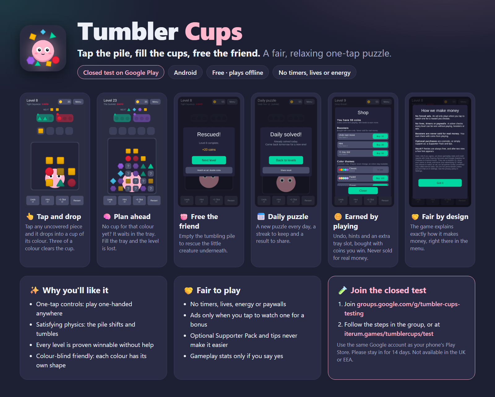

Tumbler Cups is in closed testing on Google Play, and we'd love your help. Testing is free, takes about two minutes to join, and works on any Android phone.

The testing group, with the latest news and a place to ask questions, is here: **[Tumbler Cups testing group](https://groups.google.com/g/tumbler-cups-testing)**.

<strong>Use one Google account for everything.</strong> The account you join the group with and sign up as a tester with must be the same account that is signed in to the Play Store on your Android phone. If they differ, the Play Store says the app isn't available. To check, open the Play Store app and tap your profile picture (top right); you can switch accounts there.

## 1. Join the testing group

Open the [Tumbler Cups testing group](https://groups.google.com/g/tumbler-cups-testing) and click **Join group**.

## 2. Become a tester

Open [play.google.com/apps/testing/com.iterumgames.tumblercups](https://play.google.com/apps/testing/com.iterumgames.tumblercups) and tap **Become a tester**. Wait until the page says you are a tester.

## 3. Install the game on your phone

On your Android phone, open the [Tumbler Cups Play Store page](https://play.google.com/store/apps/details?id=com.iterumgames.tumblercups) and install it.

**On a computer?** Scan this code with your phone's camera to open the install page:

The game doesn't show up in a Play Store search during testing, so always use the link or the code.

## What the game is like

## Please stay for 14 days

Google needs testers to stay opted in for 14 days before a game can be released to everyone. Leaving the game installed and playing now and then is a big help.

## Good to know

- **"App not available"?** Check that your phone's Play Store uses the same account as steps 1 and 2, then wait a few minutes and try again: joining can take a little while to reach the Play Store.
- The test isn't available in the UK or the European Economic Area.
- **Feedback:** tell us which levels felt too hard or too easy and anything that looked broken. Post in the [testing group](https://groups.google.com/g/tumbler-cups-testing) or email [info@iterum.games](mailto:info@iterum.games).
